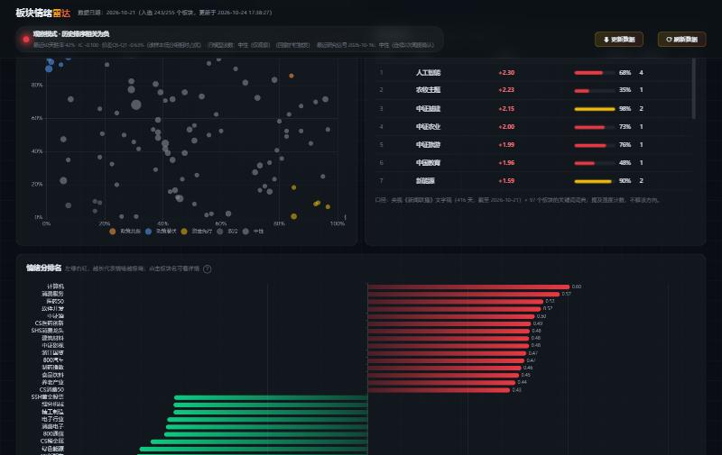
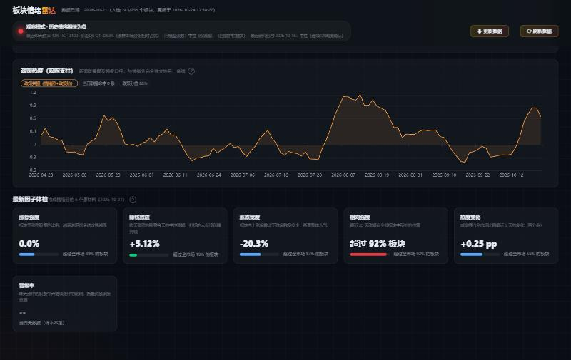

# Emotion-A：A 股板块情绪 + 政策双因量化观察系统

[](LICENSE)
[](requirements.txt)
[](tests/)
[](https://github.com/waytowiner/Emotion-A)

> **情绪 × 政策，双因并驱的 A 股板块观察雷达。**
> 情绪支柱：全市场板块冷热、情绪分排名与微观体感；政策支柱：新闻联播时政提及强度。
> 全部纯计算、无黑盒、数字严格可复现；在经历严格的实盘 ETF 回测与摩擦成本归因后，
> 确立为纯粹的**盘面观察工具**——不生成买卖建议。

> ⚠️ **开源与商用声明**：本项目遵循 [非商业开源许可协议](LICENSE)，源码公开仅供个人学习与学术研究。
> **未经原作者书面正式授权，严禁任何形式的商业化用途；商用需另行付费取得商业授权**（详见文末授权条款）。


---

## 目录

- [双因驱动总览](#双因驱动总览)
- [情绪支柱方法论](#一情绪支柱方法论)
- [政策支柱方法论](#二政策时政支柱方法论)
- [双因交叉信号](#三双因交叉信号)
- [实战回测与科学裁决](#策略实战回测与深度归因)
- [看板功能](#看板功能与日常观察)
- [快速上手](#极简运行指南)
- [数据更新流程](#观察期的数据更新流程)
- [商用授权](#开源协议与商用授权声明)
- [免责声明](#免责声明)

---

## 双因驱动总览

A 股的题材行情由两只手推动：**资金情绪**（涨停、连板、赚钱效应——市场微观体感）与**政策时政**（联播、文件、会议——自上而下的注意力）。Emotion-A 用两条完全平行、口径可对照的支柱分别量化这两只手：

```
            ┌─────────────────────────────────────────────┐
            │              Emotion-A 双因观察               │
            ├───────────────────────┬─────────────────────┤
            │   情绪支柱（已冻结）   │  政策支柱（2026-10 新增）│
            │   · 6 因子打分         │  · 新闻联播文字稿      │
            │   · 涨停/赚钱效应/宽度 │  · 97 板块关键词词典   │
            │   · 5 日平滑 + 分位    │  · 三口径提及强度      │
            ├───────────────────────┴─────────────────────┤
            │        双因交叉：情绪分位 × 政策分位          │
            │   政策共振 / 政策潜伏 / 资金先行 / 双冷         │
            └─────────────────────────────────────────────┘
```

**设计纪律**：政策支柱与情绪支柱完全解耦——不进情绪合成、不参与回测调参、不触碰
冻结的 config.yaml（SHA256 校验），两条线各自透明可审计。

---

## 一、情绪支柱方法论

### 1. 为什么构建“板块情绪”？

A 股市场具有鲜明的散户与游资参与特征，涨跌停板制度使得微观“赚钱效应”与“亏损效应”在不同行业板块间快速传导与发酵：

- **游资连板与打板生态**：涨停往往是市场资金聚焦的放大器，封板意愿与晋级率直接反映资金进攻意愿；
- **真实体感（中位数原则）**：板块涨幅往往被权重股或单一妖股失真拉高，本项目优先采纳中位数口径（如昨日涨停今日涨幅中位数），还原多数交易者的真实体感；
- **情绪同步而非神谕**：情绪指标本质是**市场微观状态的“体温计”**，擅长精准捕捉正在发生的资金切换与高低切，但它不是脱离基本面的未来水晶球。

### 2. 六因子打分体系

因子全部按板块聚合计算，每日在全板块横截面上标准化：

| 因子名称 | 计算口径与核心逻辑 | 属性方向 |
|---|---|:---:|
| **涨停强度** | 板块内涨停家数 / 板块内交易家数，衡量题材攻击热度 | 正向 |
| **赚钱效应** | 昨日涨停股今日涨幅的**中位数**，反映短线次日溢价体感 | 正向 |
| **涨跌宽度** | (上涨家数 − 下跌家数) / 交易家数，刻画板块普涨与普跌扩散度 | 正向 |
| **相对强度 RPS** | 板块 20 日收益在全市场的历史分位，捕捉中期趋势动量 | 正向 |
| **热度变化** | 板块成交额占全市场总成交比例的 5 日变化，监测增量资金流入 | 正向 |
| **接力晋级率** | 昨日涨停个股今日连板的比例，反映短线情绪持续性 | 正向 |

- **去极值与合成**：横截面 z-score 并在 $\pm 3$ 范围硬截断，防止单日极端个股绑架综合得分；
- **均值平滑**：加权后经 5 日滑动均值平滑生成“周度综合情绪分”，过滤高频噪声。

### 3. 市场风格自适应机制 (Regime Adaptive)

市场并非长期处于单边趋势，情绪因子的有效性具有强烈的周期性：

- **动量与反转动态判定**：基于滚动已实现 IC（无前视、后移至可知时点）动态划分三种市场状态：
  - **动量市 (Momentum)**：高分板块持续占优，高分具有正向动量溢价；
  - **反转市 (Mean-reversion)**：市场缩量轮动，追高往往遭套，低分跌透板块更具反弹性价比；
  - **观望市 (Neutral)**：信号失真或价差无序时主动降级，防范无效磨损。
- **两道关键风控护栏**：
  - **单调性破坏预警**：当分层多空价差（$Q5 - Q1$）连续反向时，比均值 IC 翻负提前一周降级观望；
  - **回撤护栏**：全市场指数短期累计下跌超阈值时，强制退出方向性头寸。

---

## 二、政策（时政）支柱方法论

情绪是市场微观状态的体温计，但 A 股的另一只手是**政策与时政**。政策支柱与情绪支柱完全平行，形成双因并驱的观察框架：

### 1. 数据口径

- **唯一数据源**：央视《新闻联播》文字稿——权威时政源，逐条含标题与正文，可完整回填 2016 年至今的历史（本项目自 2025-09-01 起回填 418 天 / 5650 条）；
- **抓取与缓存**：一天一文件增量缓存、断点续跑、连续 8 次失败自动中止。

### 2. 关键词词典映射（零黑盒）

`config/policy_keywords.yaml` 维护 **97 个板块 × 444 个政策语境高频词**的映射，纯字符串匹配：

```yaml
"H30184":                    # 半导体
  name: 半导体
  terms: [半导体, 芯片, 集成电路, 晶圆代工, 存储芯片]
"931855":                    # 通用航空（低空经济）
  name: 通用航空
  terms: [低空经济, 通用航空, 无人机, 低空空域, eVTOL]
```

**计数口径**：一条新闻命中某板块任意关键词，该板块当日“政策命中”+1（按新闻条数去重，不按关键词出现次数累计）——即**提及强度**，而非利好利空方向。词典可自行增删，所有代码与 ETF 板块池自动校验。

### 3. 政策三口径与政策分

| 口径 | 计算方式 | 衡量什么 |
|---|---|---|
| **政策强度** | 当日命中条数 | 当日联播提及密度 |
| **政策热度** | 近 5 日滚动命中累计 | 短期话题持续性 |
| **政策广度** | 近 10 日内出现命中的天数占比 | 话题覆盖的稳定度 |

三口径横截面 z-score（±3 截断）等权合成“政策分”，与情绪分**同 5 日平滑、同 120 日时序分位**——两条支柱的读数可以并排对照。

### 4. 双因交叉信号

基于情绪分位 × 政策分位的四象限（阈值 80% / 20%），每个板块每日归入五种状态之一：



| 双因状态 | 象限 | 观察含义 |
|---|---|---|
| 🔶 **政策共振** | 情绪热 + 政策热 | 题材同时有资金关注与时政话题加持，观察重点 |
| 🔵 **政策潜伏** | 情绪冷 + 政策热 | 政策已至、盘面未动——政策驱动型观察 |
| 🟡 **资金先行** | 情绪热 + 政策冷 | 纯资金驱动、无政策背书，观察退潮风险 |
| ⚫ **双冷** | 情绪冷 + 政策冷 | 两条线都无热度 |
| · **中性** | 其余中间带 | 任一侧处于历史中段 |

**纪律红线**：政策分统计的是联播的**提及强度**，不区分利好利空；政策支柱与已冻结的情绪合成分、回测口径、一致性验证**完全解耦**——不进入情绪因子体系、不参与任何参数调优与重启门槛判定，全部输出仅描述状态。

板块详情页可看单板块的政策分时序与当前双因状态徽章：



---

## 策略实战回测与深度归因

为检验情绪逻辑能否直接指导实盘交易，我们将板块情绪分严格映射至**二级市场真实可交易的行业/主题 ETF 池**，并计入真实交易摩擦（买卖各 5bps 手续费 + 5bps 冲击滑点，次日开盘成交），进行了多轮严肃诊断与归因：

### 实验一：真实 ETF 交易回测与损耗归因


#### 核心发现与痛点剖析：

1. **两极配置的巨大回撤**：
   - **固定追高 (Top3)**：在情绪高潮期爆发力强，但极易在行情退潮中遭遇断崖式补跌，最大回撤高达 **-41.90%**；
   - **固定抄底 (Bottom3)**：陷入阴跌甚至流动性折价泥潭，累计大幅亏损 **-25.73%**。
2. **自适应策略的磨损本质**：
   - 尽管自适应机制通过“观望降级”规避了一定回撤（最大回撤控制在 -17.22%），但净收益最终仍跑输基准；
   - **摩擦成本吞噬收益**：周度高频调仓在全样本期累积了 **2.26% ~ 8%** 以上的交易手续费与滑点损耗；
   - **信号滞后与拥挤度**：情绪分本质是右侧确认指标，当周度信号确认触发追进时，往往已处于题材行情的后半程，面临风格突变带来的调仓滞后。

---

### 实验二：相关性去重与情绪增量实验（终局裁决）

针对周度调仓换手率过高和板块间同质化的问题，我们设计了最后一轮**降频去重优化实验**：

1. **降低调仓频率**：改为月度调仓，大幅压降换手率与交易磨损；
2. **相关性完全聚类去重**：基于过去 60 日收益率相关性（$\ge 0.90$）对全市场近 200 只 ETF 进行贪心完全连接聚类，每组选出 1 只最具代表性的核心 ETF，剔除同质化拥挤敞口；
3. **小幅情绪倾斜**：在去重等权代表篮子（组合 B）基础上，仅根据组内情绪排名施加 $\pm 20\%$ 的相对权重微调（组合 C），检验情绪带来的纯 Alpha 增量。


#### 关键数据对照（2025-09 至 2026-10，真实行情）：

| 组合方案 | 运作机制 | 扣费后净收益 | 成本损耗 | 最大回撤 | 压力测试(双倍成本) |
|---|---|---:|---:|---:|---:|
| **组合 A (基准)** | 同池月度等权 | **+0.61%** | 0.25% | -14.56% | +0.36% |
| **组合 B (去重)** | 历史相关性去重月度等权 | **-1.56%** | 0.79% | -14.79% | -2.35% |
| **组合 C (情绪)** | 去重代表组合 ＋ 情绪相对权重倾斜 | **-1.56%** | 0.84% | -14.84% | -2.39% |

#### 科学结论与终止研发原则：

- **事前规则锁死（Pre-registered）**：计算前通过 SHA256 哈希固化输入数据与实验逻辑，杜绝任何事后调参（Data Dredging）；
- **增量收益无法覆盖成本**：情绪组合 C 相对无偏组合 B 的无成本毛增量仅为 **+0.044%**，而调仓带来的增量成本损耗为 **-0.044%**，最终扣费净增量仅为 **+0.000038%**；在双倍成本压力测试下甚至变为负值；
- **拒绝过拟合**：面对不达预期的实验结果，量化研究的底线是**承认规律与边界**，不通过反复更改参数或寻找局部片段把曲线“修好看”。**项目正式终止情绪作为直接买卖交易指令的路线，全面转型为纯粹的市场冷热观察与体检雷达。**

---

## 看板功能与日常观察

虽然情绪不能直接作为无脑交易黑盒，但作为**盘面微观体温计**，其在题材热度演进、资金流向监控与风险预警方面具备极高的辅助价值。系统提供本地运行的高性能深色 Web 看板：

- **今日情绪大灯**：实时监测全市场已实现 IC 与分层价差，标注当前市场是动量、反转还是混乱观望；
- **冷热异动榜单**：
  - **升温榜 / 降温榜**：情绪分连续 3 日单调走强/转弱的板块；
  - **亢奋区 / 冰点区**：时序历史分位处于前 10% 或后 10% 的极值预警；
  - **高低切换预警**：前期高位题材正在降温、低位板块快速抬头的资金轮动异动；
- **政策（时政）双因矩阵**：
  - **双因状态矩阵图**：情绪分位 × 政策分位四象限散点，识别政策共振 / 政策潜伏 / 资金先行 / 双冷状态；
  - **政策热度榜**：新闻联播提及强度口径的板块排行（含当日命中条数）；
  - **板块详情政策线**：单板块政策分时序与当前双因状态徽章；
- **ETF 与龙头股一键穿透**：板块直接关联二级市场流动性最佳的挂钩 ETF；无 ETF 覆盖的细分赛道自动提取近期的连板情绪龙头与流动性核心个股。

---

## 极简运行指南

本项目环境极简，基于 Python 本地运行：

```bash
# 1. 安装核心依赖
pip install -r requirements.txt
pip install fastapi uvicorn

# 2. 回填政策支柱新闻缓存（首次约 10 分钟，逐日断点续跑）
python scripts/fetch_cctv_news.py --start 2025-09-01

# 3. 抓取板块/个股行情缓存（首次运行，耗时约 40 分钟）
python scripts/fetch_etf_boards.py
python scripts/fetch_stock_history.py --update

# 4. 导出看板数据（纯本地计算，约 1-2 分钟）
python scripts/dump_dashboard_data.py

# 5. 启动看板服务
python server.py
# 浏览器访问：http://127.0.0.1:8000
```

> Windows 用户也可以直接双击 `run.bat` 一键启动。

---

## 观察期的数据更新流程

项目自 2026-10-13 起为**观察工具**：不再每日自动采集，需手动同步。手动同步按以下顺序执行（各步约耗时见括号）：

```bash
# 1. 板块日线增量（中证 ETF 口径 255 个，约 14 分钟）
python scripts/fetch_etf_boards.py

# 2. 个股日线增量（约 25 分钟；缺口>1 日走 baostock 逐股路径）
python scripts/fetch_stock_history.py --update

# 3. 政策（时政）支柱增量：新闻联播文字稿（增量约数秒；建议 21:00 后运行）
python scripts/fetch_cctv_news.py

# 4. 生成情绪日报（约 50 秒，自动附带政策观察段）
python main.py

# 5. 异动榜计算（约 20 秒）
python scripts/daily_anomaly.py

# 6. 导出看板数据（约 70 秒，含双因矩阵与政策榜）
python scripts/dump_dashboard_data.py

# 7. 一致性验证（约 2 分钟，核对 58 个调仓日读数与回测一致）
python scripts/validate_consistency.py

# 8. 研究重启门槛检查（只读，判定写入 report/restart_gate.json）
python scripts/check_restart_gate.py
```

**注意事项**

- 第 1 步受中证接口限流影响，脚本内置“连续 8 次失败即中止”保护；中断后直接重跑即可断点续跑，已缓存板块不重复发请求。
- 第 2 步 baostock 服务端会随机断线（日志出现 `baostock relogin failed`）；断线是暂时的，**直接重跑第 2 步，不要改代码**。
- 第 1、2 步必须**收盘后**（15:05 起）运行，否则取到的是上一交易日口径。
- 第 3 步政策支柱：联播文字稿在当日 21:00 后才完整；当日无缓存时日报自动降级为不含政策段，不阻断主线。
- 第 7 步必须通过：配置 SHA256 应为 `a748d53a...`，58 个调仓日的读数与回测须逐项一致（容差 1e-12）。
- 第 8 步是观察期的关键闸门：只有当滚动 IC 回到零轴上方**且**连续两个月胜率站上 50%，才可讨论重启研究路线。门槛已预注册在 `report/prospective_log.md` 表头。
- 全部步骤为**只读计算或增量缓存写入**，不修改 `config.yaml`，不调任何参数。

**可选诊断项**（不进日报主线，仅供研究）：

```bash
python scripts/fetch_fund_flow.py   # 资金流缓存，2887 只约 70 分钟；东财接口限流后需分批重跑
python scripts/diag_fund_flow.py    # 主力净流入因子诊断
```

---

## 项目结构

```
Emotion-A/
├── emotion/                  # 核心计算库
│   ├── pipeline.py           #   数据装配（板块/个股/K线/交易日历）
│   ├── factors.py            #   情绪 6 因子（涨停/赚钱效应/宽度/RPS/热度/晋级率）
│   ├── score.py              #   z-score 合成、平滑、时序分位
│   ├── signal.py             #   冷热异动信号层
│   ├── policy.py             #   政策支柱：命中计数/三口径/双因状态
│   ├── backtest.py           #   IC 分析、分层、轮动回测、风格判定
│   ├── report.py             #   日报生成（Markdown + CSV）
│   └── data/                 #   数据源适配（中证/东财/联播文字稿缓存）
├── scripts/                  # 抓取/回填/验证脚本
├── static/                    # 看板前端（纯原生 JS + ECharts）
├── server.py                 # FastAPI 看板后端
├── config.yaml               # 情绪主线配置（SHA256 冻结）
├── config/policy_keywords.yaml  # 政策关键词词典（可自行增删）
└── tests/                    # 124 个单元测试
```

---

## 开源协议与商用授权声明 (License & Commercial Terms)

### 🆓 个人与学术使用：免费

本项目采用 **[非商业开源许可协议 (Non-Commercial Open License)](LICENSE)** 发布。允许任何**个人、高校及研究人员**在非商业目的下免费：

1. 阅读、下载、学习、研究本项目的全部代码与因子算法；
2. 在个人设备上本地部署、测试与自用；
3. 基于研究目的修改与二次衍生（衍生项目须保持相同非商业授权属性并保留署名）。

### 💰 商业使用：须付费取得书面授权

**未经原作者事先书面正式授权并支付相应授权费用，严禁任何组织、机构、企业或个人将本项目的全部或部分代码、算法模型、因子体系、看板界面或衍生方案用于任何直接或间接的商业用途**，包括但不限于：

| 禁止的商用场景 | 说明 |
|---|---|
| 商业软件 / SaaS 集成 | 集成到收费金融终端、投研平台、小程序、API 或量化系统 |
| 付费投顾与社群变现 | 用本项目榜单/信号/数据做付费星球、会员订阅、付费研报、自媒体商业变现 |
| 资管与实盘运营 | 企业、私募或资管团队将算法用于商业自营或受托资金管理 |
| 技术转让与收费培训 | 打包为收费培训课件、商业咨询或技术转让 |

### 📮 商业授权洽谈

如需商业授权或业务合作，请**事先**联系原作者取得书面授权：

- **GitHub**：[@waytowiner](https://github.com/waytowiner)
- **Email**：[enixzhang@gmail.com](mailto:enixzhang@gmail.com)

> 任何未经授权的商用行为均构成对本许可协议的违反，原作者保留依法追究的权利。

---

## 免责声明

1. 本项目所有数据指标、模型输出与看板界面**仅作为量化研究与市场观察参考，绝不构成任何具体的投资建议或买卖指令**。
2. 政策支柱统计的是新闻联播**提及强度**，不代表政策利好或利空方向，不构成对任何政策内容的解读。
3. 历史回测基于特定样本与历史回溯口径，不代表未来表现。投资有风险，入市需谨慎。
