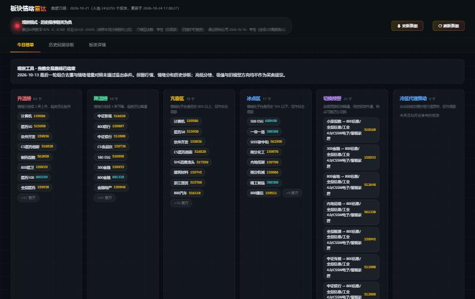
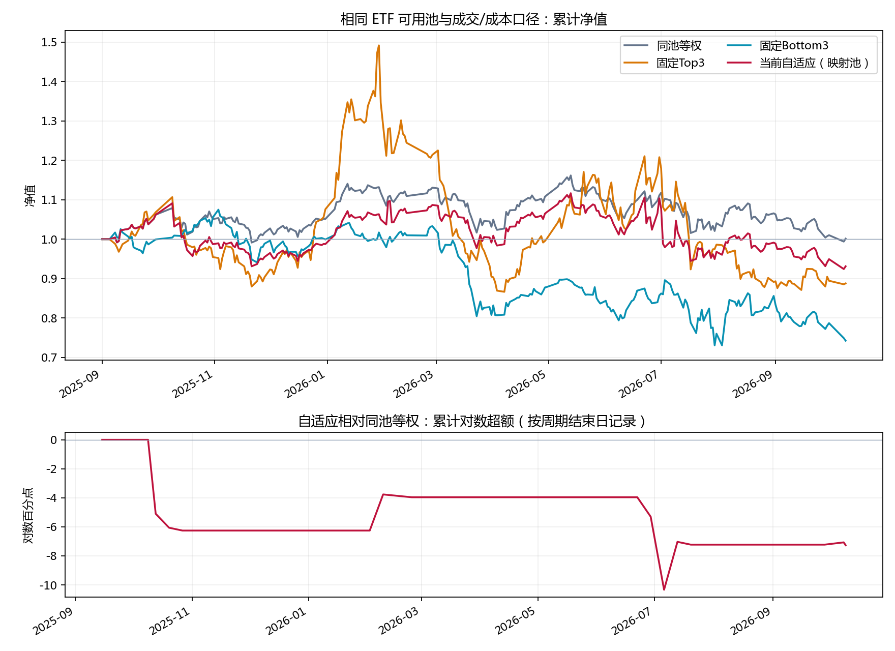
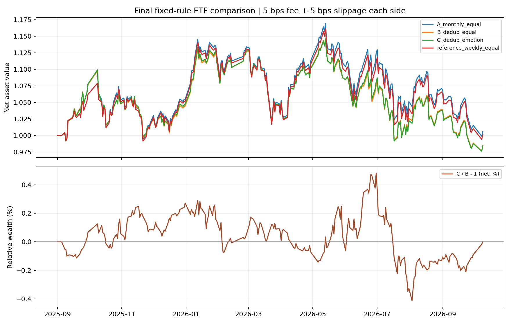

# Emotion-A：A 股板块情绪量化观察系统

[](LICENSE)
[](https://github.com/waytowiner/Emotion-A)

> **客观呈现全市场板块冷热、情绪分排名与微观体感。**
> 全部纯计算、无黑盒、数字严格可复现；在经历严格的实盘 ETF 回测与摩擦成本归因后，确立为纯粹的**盘面情绪观察工具**。
> 
> ⚠️ **开源与商用声明**：本项目遵循 [非商业开源许可协议](LICENSE)，源码公开仅供个人学习与学术研究。**未经原作者书面正式授权，严禁任何形式的商业化用途（包括商业软件集成、付费投顾/研报变现、资管实盘等）**。



---

## 策略思路与方法论

### 1. 为什么构建“板块情绪”？
A 股市场具有鲜明的散户与游资参与特征，涨跌停板制度使得微观“赚钱效应”与“亏损效应”在不同行业板块间快速传导与发酵：
- **游资连板与打板生态**：涨停往往是市场资金聚焦的放大器，封板意愿与晋级率直接反映资金进攻意愿；
- **真实体感（中位数原则）**：板块涨幅往往被权重股或单一妖股失真拉高，本项目优先采纳中位数口径（如昨日涨停今日涨幅中位数），还原多数交易者的真实体感；
- **情绪同步而非神谕**：情绪指标本质是**市场微观状态的“体温计”**，擅长精准捕捉正在发生的资金切换与高低切，但它不是脱离基本面的未来水晶球。

### 2. 因子体系与打分机制
因子全部按板块聚合计算，每日在全板块横截面上标准化：

| 因子名称 | 计算口径与核心逻辑 | 属性方向 |
|---|---|:---:|
| **涨停强度** | 板块内涨停家数 / 板块内交易家数，衡量题材攻击热度 | 正向 |
| **赚钱效应** | 昨日涨停股今日涨幅的**中位数**，反映短线次日溢价体感 | 正向 |
| **涨跌宽度** | (上涨家数 − 下跌家数) / 交易家数，刻画板块普涨与普跌扩散度 | 正向 |
| **相对强度 RPS**| 板块 20 日收益在全市场的历史分位，捕捉中期趋势动量 | 正向 |
| **热度变化** | 板块成交额占全市场总成交比例的 5 日变化，监测增量资金流入 | 正向 |
| **接力晋级率** | 昨日涨停个股今日连板的比例，反映短线情绪持续性 | 正向 |

- **去极值与合成**：横截面 z-score 并在 $\pm 3$ 范围硬截断，防止单日极端个股绑架综合得分；
- **均值平滑**：加权后经 5 日滑动均值平滑生成“周度综合情绪分”，过滤高频噪声。

### 3. 市场风格自适应机制 (Regime Adaptive)
市场并非长期处于单边趋势，情绪因子的有效性具有强烈的周期性：
- **动量与反转动态判定**：基于滚动已实现 IC（无前视、后移至可知时点）动态划分三种市场状态：
  - **动量市 (Momentum)**：高分板块持续占优，高分具有正向动量溢价；
  - **反转市 (Mean-reversion)**：市场缩量轮动，追高往往遭套，低分跌透板块更具反弹性价比；
  - **观望市 (Neutral)**：信号失真或价差无序时主动降级，防范无效磨损。
- **两道关键风控护栏**：
  - **单调性破坏预警**：当分层多空价差（$Q5 - Q1$）连续反向时，比均值 IC 翻负提前一周降级观望；
  - **回撤护栏**：全市场指数短期累计下跌超阈值时，强制退出方向性头寸。

---

## 策略实战回测与深度归因

为检验该逻辑能否直接指导实盘交易，我们将板块情绪分严格映射至**二级市场真实可交易的行业/主题 ETF 池**，并计入真实交易摩擦（买卖各 5bps 手续费 + 5bps 冲击滑点，次日开盘成交），进行了多轮严肃诊断与归因：

### 实验一：真实 ETF 交易回测与损耗归因



#### 核心发现与痛点剖析：
1. **两极配置的巨大回撤**：
   - **固定追高 (Top3)**：在情绪高潮期爆发力强，但极易在行情退潮中遭遇断崖式补跌，最大回撤高达 **-41.90%**；
   - **固定抄底 (Bottom3)**：陷入阴跌甚至流动性折价泥潭，累计大幅亏损 **-25.73%**。
2. **自适应策略的磨损本质**：
   - 尽管自适应机制通过“观望降级”规避了一定回撤（最大回撤控制在 -17.22%），但净收益最终仍跑输基准；
   - **摩擦成本吞噬收益**：周度高频调仓在全样本期累积了 **2.26% ~ 8%** 以上的交易手续费与滑点损耗；
   - **信号滞后与拥挤度**：情绪分本质是右侧确认指标，当周度信号确认触发追进时，往往已处于题材行情的后半程，面临风格突变带来的调仓滞后。

---

### 实验二：相关性去重与情绪增量实验（终局裁决）

针对周度调仓换手率过高和板块间同质化的问题，我们设计了最后一轮**降频去重优化实验**：
1. **降低调仓频率**：改为月度调仓，大幅压降换手率与交易磨损；
2. **相关性完全聚类去重**：基于过去 60 日收益率相关性（$\ge 0.90$）对全市场近 200 只 ETF 进行贪心完全连接聚类，每组选出 1 只最具代表性的核心 ETF，剔除同质化拥挤敞口；
3. **小幅情绪倾斜**：在去重等权代表篮子（组合 B）基础上，仅根据组内情绪排名施加 $\pm 20\%$ 的相对权重微调（组合 C），检验情绪带来的纯 Alpha 增量。



#### 关键数据对照（2025-09 至 2026-10，真实行情）：

| 组合方案 | 运作机制 | 扣费后净收益 | 成本损耗 | 最大回撤 | 压力测试(双倍成本) |
|---|---|---:|---:|---:|---:|
| **组合 A (基准)** | 同池月度等权 | **+0.61%** | 0.25% | -14.56% | +0.36% |
| **组合 B (去重)** | 历史相关性去重月度等权 | **-1.56%** | 0.79% | -14.79% | -2.35% |
| **组合 C (情绪)** | 去重代表组合 ＋ 情绪相对权重倾斜 | **-1.56%** | 0.84% | -14.84% | -2.39% |

#### 科学结论与终止研发原则：
- **事前规则锁死（Pre-registered）**：计算前通过 SHA256 哈希固化输入数据与实验逻辑，杜绝任何事后调参（Data Dredging）；
- **增量收益无法覆盖成本**：情绪组合 C 相对无偏组合 B 的无成本毛增量仅为 **+0.044%**，而调仓带来的增量成本损耗为 **-0.044%**，最终扣费净增量仅为 **+0.000038%**；在双倍成本压力测试下甚至变为负值；
- **拒绝过拟合**：面对不达预期的实验结果，量化研究的底线是**承认规律与边界**，不通过反复更改参数或寻找局部片段把曲线“修好看”。**项目正式终止情绪作为直接买卖交易指令的路线，全面转型为纯粹的市场冷热观察与体检雷达。**

---

## 看板功能与日常观察

虽然情绪不能直接作为无脑交易黑盒，但作为**盘面微观体温计**，其在题材热度演进、资金流向监控与风险预警方面具备极高的辅助价值。

系统提供本地运行的高性能深色 Web 看板：
- **今日情绪大灯**：实时监测全市场已实现 IC 与分层价差，标注当前市场是动量、反转还是混乱观望；
- **冷热异动榜单**：
  - **升温榜 / 降温榜**：情绪分连续 3 日单调走强/转弱的板块；
  - **亢奋区 / 冰点区**：时序历史分位处于前 10% 或后 10% 的极值预警；
  - **高低切换预警**：前期高位题材正在降温、低位板块快速抬头的资金轮动异动；
- **ETF 与龙头股一键穿透**：板块直接关联二级市场流动性最佳的挂钩 ETF；无 ETF 覆盖的细分赛道自动提取近期的连板情绪龙头与流动性核心个股。

---

## 极简运行指南

本项目环境极简，基于 Python 本地运行：

```bash
# 1. 安装核心依赖
pip install -r requirements.txt
pip install fastapi uvicorn

# 2. 导出看板数据（纯本地计算，约 1-2 分钟）
python scripts/dump_dashboard_data.py

# 3. 启动看板服务
python server.py
# 浏览器访问：http://127.0.0.1:8000
```

---

## 开源协议与商用授权声明 (License & Commercial Terms)

本项目采用 **[非商业开源许可协议 (Non-Commercial Open License)](LICENSE)** 发布：

- **个人与学术免费**：允许任何个人、高校及研究人员免费阅读、学习、研究、修改代码及本地自用；
- **禁止未经授权的商业用途**：**严禁任何组织、机构、企业或个人未经原作者书面正式授权，将本项目的全部或部分代码、算法模型、因子体系、看板界面或衍生方案用于任何直接或间接的商业用途**（包括但不限于商业金融终端集成、SaaS服务、付费投顾社群/付费研报变现、私募/自营资金实盘运营、商业培训与技术转让等）；
- **商业授权与合作洽谈**：如需商业授权或业务合作，请事先联系原作者：
  - **GitHub**：[@waytowiner](https://github.com/waytowiner)
  - **Email**：[enixzhang@gmail.com](mailto:enixzhang@gmail.com)

---

## 免责声明

1. 本项目所有数据指标、模型输出与看板界面**仅作为量化研究与市场观察参考，绝不构成任何具体的投资建议或买卖指令**。
2. 历史回测基于特定样本与历史回溯口径，不代表未来表现。投资有风险，入市需谨慎。
